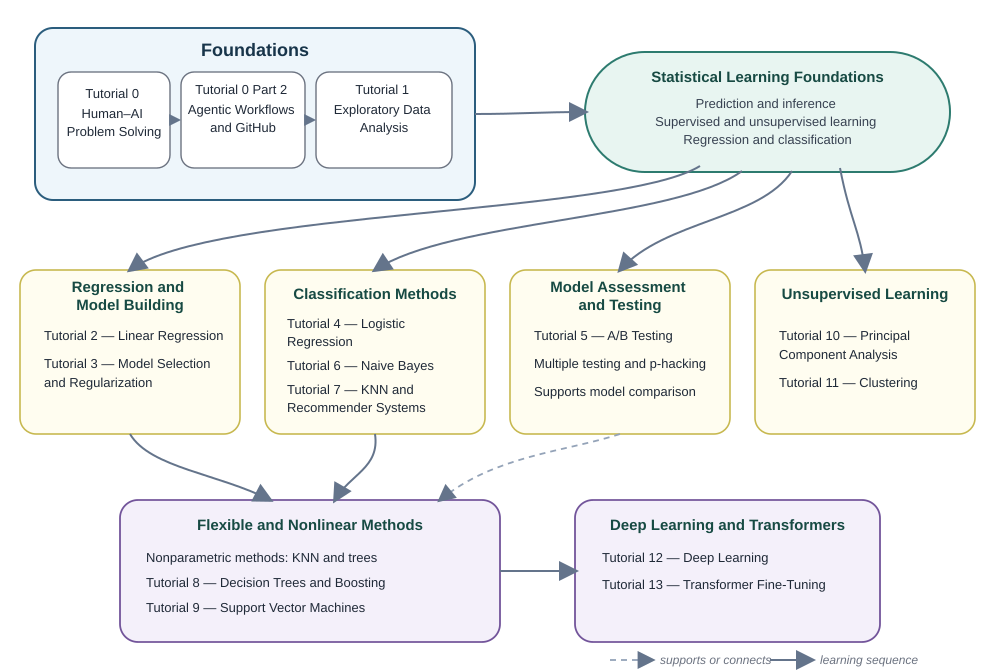

# IE 1171: AI for Social Good

*Statistical learning, human–AI collaboration, and social impact*

**IE 1171: AI for Social Good** at the University of Pittsburgh offers a hands-on introduction to machine learning and modern AI through project-based work with real-world data, including applications in public health, consumer credit, and online platforms. Technical work is paired with readings on fairness, privacy, accountability, and data ethics.

Formerly [Data for Social Good](https://news.engineering.pitt.edu/using-data-for-social-good/), the course was redesigned around mastery-based learning and AI-assisted tutorials, with a guided technical core and optional extensions.

The course supports the [Engineering Data Analytics Certificate](https://www.engineering.pitt.edu/departments/industrial/undergraduate/degrees/certificates/) and Pitt Business’s [Certificate in Foundations of AI for Business](https://www.cba.pitt.edu/academics/certificates/certificate-in-foundations-of-ai-for-business/).

## Tutorial series

The series contains **15 Jupyter notebooks**: Tutorials 0–13 and Tutorial 0 Part 2.

**Recommended background:** Familiarity with basic algebra and introductory probability and statistics will help students follow the tutorials. Some experience reading and running Python code is useful, with guided prompts and reference solutions supporting the programming work. Prior machine-learning experience is not assumed. Later tutorials use vectors, matrices, and derivatives, which students may need to review alongside the assigned readings.

**Start here:** [Tutorial 0](Tutorials/Tutorial%200%20-%20Human-AI%20Problem%20Solving%20with%20Claude/Tutorial%200%20-%20Human-AI%20Problem%20Solving%20with%20Claude.ipynb) · [Tutorial guide](#tutorial-guide) · [Running the tutorials](#running-the-tutorials) · [Working with AI](#how-to-work-with-ai-in-the-tutorials)

Across the series, students connect technical decisions—how a problem is defined, what data are collected, which variables are used, how a model is evaluated, and what happens when it is wrong—to social-good applications and responsible deployment.

> **Main idea:** Learn the method, verify the result, and ask what the result means for people. AI supports the work, while students guide the process, apply domain knowledge, and remain responsible for their decisions.

---

## Social-good applications by tutorial

| Tutorial | Technical focus | Social-good connection |
|---|---|---|
| **0** | Human–AI problem solving | Human-centered problem scoping, stakeholder knowledge, alternatives to AI, and learning from unintended consequences after deployment. |
| **0 Part 2** | Agentic workflows and GitHub | Accountable public-interest software: least privilege, traceable changes, data governance, human approval, and rollback. |
| **1** | Data wrangling and exploratory data analysis | Trustworthy civic/public-interest data: context, representation, missingness, limits of anonymization, data literacy, and community knowledge before modeling. |
| **2** | Linear and multiple regression | Regression for health, housing, or resource questions while separating model fit from fairness, causality, and policy acceptability. |
| **3** | Model selection and regularization\* | Feature choices affect predictions and the decisions based on them. Examine privacy, proxy variables, differences in prediction error across groups, feedback, and monitoring. |
| **4** | Logistic regression | Human-centered classification: thresholds, false positives/negatives, marginalized groups, explanation, appeal, and accountable use. |
| **5** | A/B testing and advanced multiple-testing procedures\* | Examine how analytical choices affect the credibility of experimental findings, alongside ethical randomization, meaningful outcomes, unintended consequences, and replication. |
| **6** | Naive Bayes | Use conditional probability to examine randomized response and sensitive inferences, then consider how predictions can support human decisions under uncertainty. |
| **7** | KNN and recommender systems | Recommendation shapes exposure, popularity, choice, and future data. Examine feedback loops, subgroup performance, and privacy. |
| **8** | Decision trees and boosting | Evaluate accuracy alongside error consequences, restricted inputs, proxy variables, errors across intersecting groups, competing fairness goals, and expert oversight. |
| **9** | Support vector machines | Connect word-vector representations to classification and examine how features and decision boundaries can shape attention and opportunity in the ad-click example. |
| **10** | PCA and principal components regression (PCR)\* | Revisit the word-embedding case using PCA. Examine how representation choices affect information and social associations, and why compression alone does not establish privacy or fairness. |
| **11** | Clustering | Connect the shopping and recommendation readings to customer segmentation. Examine how grouping choices affect treatment and why clusters should not be treated as fixed identities. |
| **12** | Deep learning | Use smoking-status predictions and group error rates to examine uncertainty, privacy, unwanted interventions, human oversight, and monitoring after deployment. |
| **13** | Transformer fine-tuning | Examine trust and privacy in license-plate redaction, including missed detections, identifying information that remains after redaction, and possible surveillance uses. Distinguish redaction from differential privacy. |

\* Marks optional Level 2 extensions in the Technical focus column.

### Frameworks for Human–AI Problem Solving

Two complementary frameworks connect the work in each notebook to the decisions in an analytics project.

George Pólya’s [*How to Solve It: A New Aspect of Mathematical Method*](https://press.princeton.edu/books/paperback/9780691164076/how-to-solve-it) provides the problem-solving framework used throughout these tutorials: **Understand the Problem → Devise a Plan → Carry Out the Plan → Look Back**. We use this structure to make AI a collaborator in developing and testing ideas throughout the problem-solving process. The four colored gears mark these stages throughout the notebooks, and students return to earlier stages when new evidence changes their understanding or calls for a revised plan.

The [**INFORMS Analytics Framework (IAF)**](https://www.informs.org/Professional-Development/INFORMS-Analytics-Framework) connects that reasoning to the wider project. Its seven domains cover the human or organizational problem, the analytical question, data, method selection, model development, deployment, and the continuing management of a solution. In our social-good projects, its term *business problem* refers to the community or organizational need and the decision we hope to improve.

  
  

**We use Pólya’s cycle within any IAF domain.** The [Human–AI Problem Solving question sheet (PDF)](Tutorials/Tutorial%200%20-%20Human-AI%20Problem%20Solving%20with%20Claude/Human-AI%20Problem%20Solving.pdf) and [IAF Guiding Questions (PDF)](Tutorials/Tutorial%200%20-%20Human-AI%20Problem%20Solving%20with%20Claude/IAF_Guiding_Questions.pdf) guide students’ own reasoning and their conversations with AI: clarify the problem, examine assumptions, compare alternatives, and identify a next step they can verify. Connect selected questions to the project’s evidence and constraints, then check the proposed answers.

The question sheets and **Human Checks** provide starting points. In their projects, students should draw on domain knowledge, consult people affected by the proposed solution, and add questions specific to their setting, while remaining responsible for checking AI suggestions and deciding how to act.

---

## What each tutorial includes

The notebooks combine:

- **Learning objectives and assigned reading** that introduce the method and its social-good context.
- **Theory** connected to the code.
- **Pólya checkpoints and selected IAF guiding questions** to structure reasoning and analytical decisions.
- **Manual Pauses** for independent thinking before asking AI.
- **Focused AI tasks** with specific, verifiable outputs.
- **Your Workspace** cells for student work and **Reference Solutions** for comparison after an attempt.
- **Human Checks and Look Back sections** to verify results, interpret limitations, and identify what to revise.
- **Social-good applications** tied to the method, data, and consequences of the analysis.

### Level 1 and Level 2

**Level 1 is the required core. Level 2 provides optional extensions** that build on that foundation. The [tutorial guide](#tutorial-guide) identifies the work at each level.

Consult each notebook’s **Assigned Reading** section for required readings and any optional references or review of earlier material. Students can follow the core sequence without completing earlier optional activities. For example, Tutorial 3 assigns cross-validation even if students skipped Tutorial 2’s optional activity.

---

## Course concept chart

The chart shows how the course topics connect, from problem framing and data exploration to regression, classification, unsupervised learning, and neural networks. It suggests a learning sequence and highlights relationships across topics. It includes both core topics and optional extensions, which are distinguished in the tutorial guide below.

  

### How to read the chart

- Begin with **Foundations**. The larger boxes group related topics, and the labels identify their tutorials.
- Solid arrows suggest a learning sequence. Dashed arrows show supporting connections.
- Method families overlap. For example, KNN and decision trees are nonparametric methods covered in Tutorials 7 and 8.

---

## Course-wide learning objectives

By the end of the series, students should be able to:

### 1. Solve problems with AI while maintaining human judgment

- Use Pólya’s four-step cycle to understand, plan, carry out, and look back.
- Break a broad task into smaller, checkable steps.
- Use AI for support while keeping permissions, verification, and final responsibility with the human.

### 2. Prepare data and conduct exploratory data analysis

- Identify the response, predictors, rows, and units, and use a codebook to understand what the data mean.
- Clean and prepare data, using summary statistics and visualizations to explore patterns and potential problems.
- Use PCA and clustering to explore variation and groups, interpreting the results in context.

### 3. Explain and apply the foundations of statistical learning

- Explain how models learn from data, why they can overfit, and how to assess performance on new cases.
- Use training, validation, and test data appropriately to compare and tune models while avoiding data leakage.
- Interpret evaluation results and statistical uncertainty in light of the problem and the consequences of errors.

### 4. Select and apply appropriate machine learning methods

- Compare methods suited to the question and data, balancing predictive performance, simplicity, and interpretability.
- Explain how neural networks learn representations and how transformers use attention.
- Distinguish using pretrained models from fine-tuning them, and assess which approach fits the task, available data, and resources.

### 5. Apply AI ethics and responsible governance

- Apply ethical principles to assess benefits, harms, privacy, and fairness for the people affected by an AI application.
- Identify the professional responsibilities and governance needs of a proposed use, including accountability and human oversight.
- Use the IAF to connect problem framing and evaluation with deployment and ongoing monitoring.

### 6. Apply AI in context and communicate with stakeholders

- In course projects, address an engineering or social-good problem using disciplinary expertise and input from affected people.
- Communicate findings, recommendations, uncertainty, and limitations to technical and nontechnical audiences.
- Explain how the evidence supports a proposed action and what further evaluation is needed before use.

---

## Tutorial guide

Each title links to its notebook. Complete Level 1 before attempting the optional Level 2 work.

### Foundations

- **[Tutorial 0 — Human–AI Problem Solving with Claude](Tutorials/Tutorial%200%20-%20Human-AI%20Problem%20Solving%20with%20Claude/Tutorial%200%20-%20Human-AI%20Problem%20Solving%20with%20Claude.ipynb)**  
  **Level 1:** Human–AI Problem Solving  
  **Level 2:** Heuristics, Generalization, and Problem Decomposition  
  Use Pólya’s cycle and the IAF guiding questions to frame a problem, work with AI as a reasoning partner, and check proposed answers against evidence.

- **[Tutorial 0 Part 2 — Agentic Workflows with ChatGPT and GitHub](Tutorials/Tutorial%200%20Part%202%20-%20ChatGPT%20and%20GitHub/Tutorial%200%20Part%202%20-%20ChatGPT%20and%20GitHub.ipynb)**  
  **Level 1:** Agentic GitHub Workflow  
  **Level 2:** Security, Skills, Model Context Protocol (MCP), and Context Management  
  Use ChatGPT for planning and Codex for a coding workflow with defined permissions, tests, and human review.

- **[Tutorial 1 — Data Wrangling and Exploratory Data Analysis](Tutorials/Tutorial%201%20-%20Data%20Understanding%20and%20Exploration/Tutorial%201%20-%20Data%20Understanding%20and%20Exploration.ipynb)**  
  **Level 1:** Data Wrangling and Exploratory Data Analysis  
  **Level 2:** Codebook and Data-Quality Audits  
  Explore the research question, codebook, observations, missingness, and patterns before preparing analysis variables and documenting their limitations.

### Statistical learning

- **[Tutorial 2 — Linear Regression Concepts and Modeling](Tutorials/Tutorial%202%20-%20Linear%20Regression%20Concepts%20and%20Modeling/Tutorial%202%20-%20Linear%20Regression%20Concepts%20and%20Modeling.ipynb)**  
  **Level 1:** Simple and Multiple Linear Regression  
  **Level 2:** Cross-Validation and Model Diagnostics  
  Fit and interpret regression models, assess predictions, and connect the results to the research question.

- **[Tutorial 3 — Forward and Backward Model Selection](Tutorials/Tutorial%203%20-%20Forward%20and%20Backward%20Model%20Selection/Tutorial%203%20-%20Forward%20and%20Backward%20Model%20Selection.ipynb)**  
  **Level 1:** Forward and Backward Selection  
  **Level 2:** Selection Stability and Regularization  
  Compare predictor-selection procedures using validation and cross-validation, and keep test data outside model selection.

- **[Tutorial 4 — Logistic Regression](Tutorials/Tutorial%204%20-%20Logistic%20Regression/Tutorial%204%20-%20Logistic%20Regression.ipynb)**  
  **Level 1:** Binary Logistic Regression and Thresholds  
  **Level 2:** Multiclass Logistic Regression  
  Connect linear scores to probabilities and odds, then evaluate classification decisions and their errors.

- **[Tutorial 5 — A/B Testing](Tutorials/Tutorial%205%20-%20A-B%20Testing/Tutorial%205%20-%20A-B%20Testing.ipynb)**  
  **Level 1:** A/B Testing  
  **Level 2:** Multiple Testing, Optional Stopping, and Preregistration  
  Plan a randomized comparison, estimate effects and uncertainty, and examine how repeated analysis affects statistical conclusions.

### Classification and machine learning

- **[Tutorial 6 — Naive Bayes](Tutorials/Tutorial%206%20-%20Naive%20Bayes/Tutorial%206%20-%20Naive%20Bayes.ipynb)**  
  **Level 1:** Gaussian Naive Bayes  
  **Level 2:** Feature Representations, Conditional Independence, and Smoothing  
  Apply Bayes’ rule to classification and examine the assumption that predictors are conditionally independent given the class.

- **[Tutorial 7 — K-Nearest Neighbors and Recommender Systems](Tutorials/Tutorial%207%20-%20K-Nearest%20Neighbors%20and%20Movie%20Recommendation/Tutorial%207%20-%20K-Nearest%20Neighbors%20and%20Movie%20Recommendation.ipynb)**  
  **Level 1:** KNN Movie Recommendations  
  **Level 2:** Filtering by Rating Count, Distance Choice, and Recommendation Stability  
  Build a movie recommender, inspect its outputs, and examine how representation and distance choices affect its recommendations.

- **[Tutorial 8 — Decision Trees and Boosting](Tutorials/Tutorial%208%20-%20Decision%20Trees%20and%20Boosting/Tutorial%208%20-%20Decision%20Trees%20and%20Boosting.ipynb)**  
  **Level 1:** Classification Trees, Pruning, and Gradient Boosting  
  **Level 2:** XGBoost and Hyperparameter Tuning  
  Compare a decision tree with boosted ensembles and evaluate predictive performance alongside interpretability and error consequences.

- **[Tutorial 9 — Support Vector Machines](Tutorials/Tutorial%209%20-%20Support%20Vector%20Machines/Tutorial%209%20-%20Support%20Vector%20Machines.ipynb)**  
  **Level 1:** SVMs with Linear and RBF Kernels  
  **Level 2:** Hyperparameter Tuning and Subgroup Error Analysis  
  Learn margins and support vectors, use kernels for nonlinear decision boundaries, and examine classification errors.

### Unsupervised learning

- **[Tutorial 10 — Principal Component Analysis](Tutorials/Tutorial%2010%20-%20Principal%20Component%20Analysis/Tutorial%2010%20-%20Principal%20Component%20Analysis.ipynb)**  
  **Level 1:** Principal Component Analysis  
  **Level 2:** Principal Components Regression and Privacy Limits  
  Reduce dimension and interpret retained variation. The optional extension uses component scores in regression and examines privacy limits.

- **[Tutorial 11 — Unsupervised Learning and Clustering](Tutorials/Tutorial%2011%20-%20Unsupervised%20Learning%20and%20Clustering/Tutorial%2011%20-%20Unsupervised%20Learning%20and%20Clustering.ipynb)**  
  **Level 1:** K-Means Clustering, Cluster Profiles, and Stability  
  **Level 2:** Hierarchical Clustering and Linkage Sensitivity  
  Compare ways to group observations without response labels and examine how preprocessing and modeling choices change the groups.

### Deep learning and transformers

- **[Tutorial 12 — Deep Learning](Tutorials/Tutorial%2012%20-%20Deep%20Learning/Tutorial%2012%20-%20Deep%20Learning.ipynb)**  
  **Level 1:** Neural Networks and Validation  
  **Level 2:** Architecture, Learned Representations, and Attention  
  Build and evaluate a neural network and interpret its errors. Optional activities examine architecture, learned representations, and attention, with an optional reading on generative adversarial networks.

- **[Tutorial 13 — Transformer Fine-Tuning](Tutorials/Tutorial%2013%20-%20Transformer%20Fine-Tuning/Tutorial%2013%20-%20Transformer%20Fine-Tuning.ipynb)**  
  **Level 1:** License-Plate Detection and Image Redaction  
  **Level 2:** Comparing Fine-Tuning Settings, External Evaluation, and Video Redaction Design  
  Fine-tune a pretrained vision transformer, evaluate detections, and examine the privacy limits of automated redaction. The supplied training workflow requires a CUDA-capable GPU.

---

## Running the tutorials

### Before starting

GitHub displays the notebooks for reading. To execute code, open them in Google Colab or a local Jupyter environment.

1. Read the notebook’s learning objectives, assigned reading, and setup instructions.
2. Keep the notebook, data files, and `tutorial-icons` folder together. Preserve subfolders such as Tutorial 7’s `data/` directory.
3. Work through the cells in order, stopping for **Manual Pauses**, workspace tasks, and **Human Checks**.
4. Save your completed notebook and any output files needed later.

**Tutorials 2 and 3 use `tutorial_1_output.csv`, prepared in Tutorial 1.** Copies are included in their folders. Complete Tutorial 1 to understand how the variables were constructed.

### Option 1: Google Colab

[Google Colab](https://colab.research.google.com/) runs notebooks without a local Python installation.

1. Open or upload the chosen notebook in Colab and save a working copy.
2. Make the required data files available in the runtime, following the notebook’s setup instructions. Opening a notebook from GitHub does not copy its neighboring data files into the runtime.
3. Install the packages specified in the notebook and check that its data-loading step succeeds.
4. Complete the activities in order. Save or download important outputs before ending the session, because runtime files are temporary.

Colab GPU access and session limits can vary. See the [Colab FAQ](https://research.google.com/colaboratory/faq.html) for current availability and saving guidance.

### Option 2: Jupyter Notebook locally

Download or clone the repository to preserve the notebook, data, and image folders. Open the chosen notebook from its tutorial folder in Jupyter, use the environment specified by its setup instructions, and confirm that relative file paths resolve before proceeding.

### Additional requirements

- **Tutorial 0 Part 2:** The agent workflow uses Git, Python, and Codex in a terminal. Follow the notebook’s installation instructions and consult [OpenAI’s current Codex access guidance](https://help.openai.com/en/articles/11369540-using-codex-with-your-chatgpt-plan) for plan availability and limits. The notebook provides a manual ChatGPT workflow if Codex is unavailable.
- **Tutorial 13:** The supplied training workflow requires a CUDA-capable GPU and internet access to download the model and dataset. A CPU can support data inspection and small checks. In Colab, select a GPU runtime before the setup cell and verify that CUDA is available.

---

## How to work with AI in the tutorials

Use each AI task to advance one part of the problem, then check the result before continuing.

1. Complete the **Manual Pause** first.
2. Copy the prompt from the notebook.
3. Provide the relevant question, your own reasoning, and the evidence or constraints needed for the task.
4. Read the explanation and code carefully.
5. Paste the code into **Your Workspace**.
6. Run it and inspect the output.
7. Compare with the **Reference Solution** after trying it yourself.
8. Finish the **Human Check** and **Look Back** sections.

Before accepting an answer, check that it addresses the intended problem, uses the correct data and variables, and supports its claims with evidence. Explain why the method is appropriate and what its assumptions, limitations, and possible consequences mean in the application.

In course projects, recommendations about real-world use should address benefits, harms, privacy, and ongoing monitoring, drawing on relevant domain expertise.

---

## Course texts

- **Gareth James, Daniela Witten, Trevor Hastie, Robert Tibshirani, and Jonathan Taylor.** [*An Introduction to Statistical Learning with Applications in Python*](https://www.statlearning.com/). Statistical learning concepts, methods, and Python applications. A free PDF is available from the authors’ website.
- **Michael Kearns and Aaron Roth.** [*The Ethical Algorithm: The Science of Socially Aware Algorithm Design*](https://global.oup.com/academic/product/the-ethical-algorithm-9780190948207). Privacy, fairness, and the social consequences of algorithmic decisions.

Each notebook’s **Assigned Reading** section identifies the required selections, optional readings, and material revisited from earlier tutorials.
